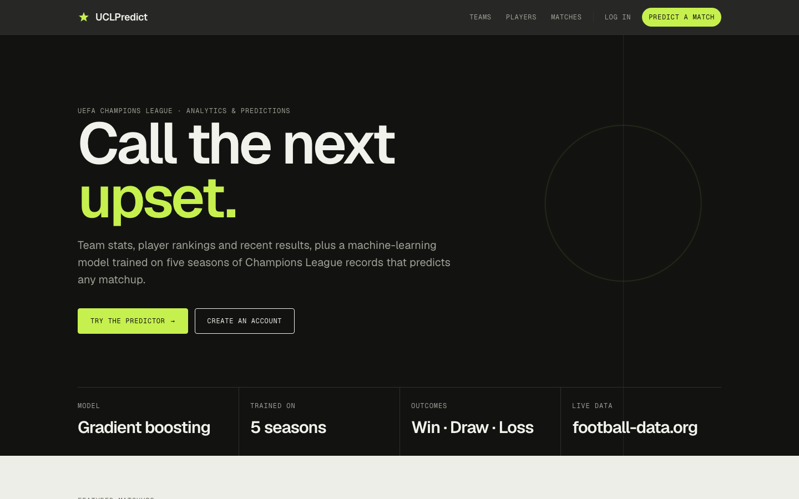

# UCLPredict

A Django web app for UEFA Champions League analytics and match predictions. Browse clubs, player rankings and recent results, then pick any two teams and a machine-learning model predicts the outcome with win, draw and loss probabilities. Signed-in users get their predictions saved to their profile.



More screens: [team page](docs/team.png) · [match preview](docs/match.png) · [player rankings](docs/players.png)

## How it's built

- Django app (`project/`) with eight models covering teams, club stats, player rankings, matches, Champions League season records and saved predictions.
- Prediction model: a scikit-learn gradient boosting classifier trained on five seasons of Champions League records (`train_ml_model.py`), loaded by `ml_predictor.py`.
- Optional live results from the football-data.org API, with a fallback to the app's own database when no key is set.
- Django auth for sign up, login and saved predictions.
- Plain HTML templates and one CSS file, with no front-end framework.

## Run it locally

```bash
python3 -m venv .venv
source .venv/bin/activate
pip install -r requirements.txt
export DJANGO_DEBUG=true
python manage.py migrate
python manage.py loaddata ucl_data
python manage.py runserver
```

Then open http://localhost:8000.

Optional: get a free key at football-data.org and `export FOOTBALL_DATA_API_KEY=...` for live match data. For anything other than local development, set the variables in `.env.example`.

Run the tests with `python manage.py test project`.

## Author

Jed Belsany · [github.com/jbel7](https://github.com/jbel7)
